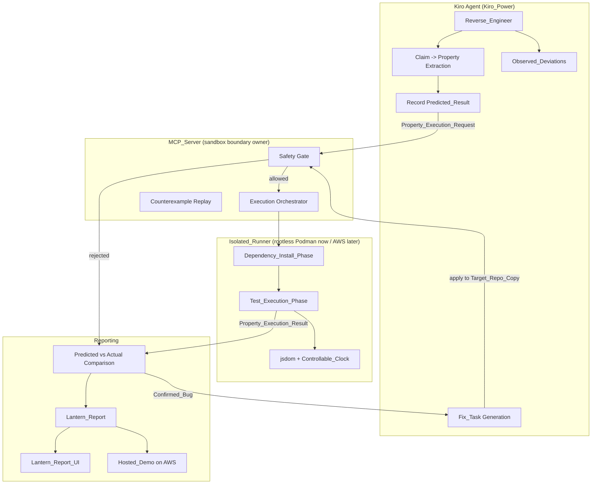
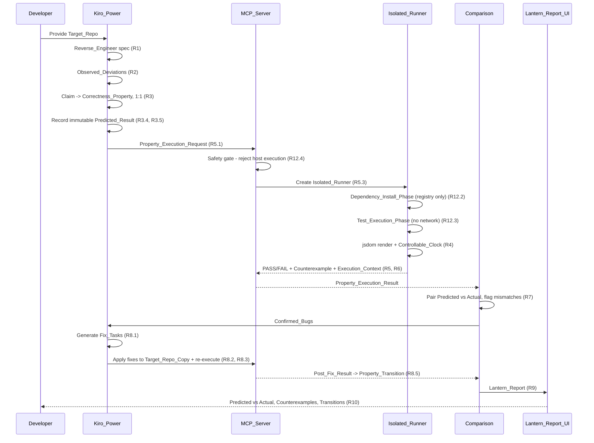
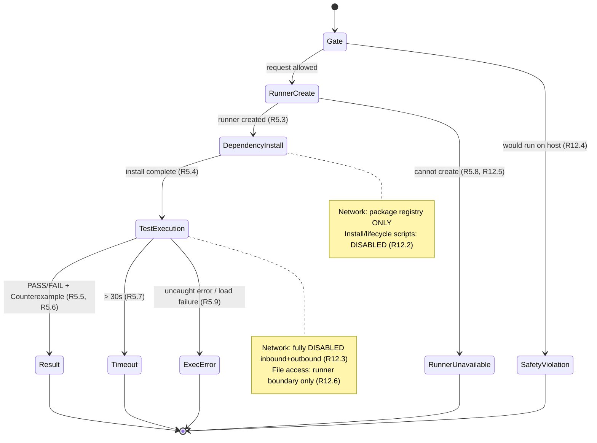
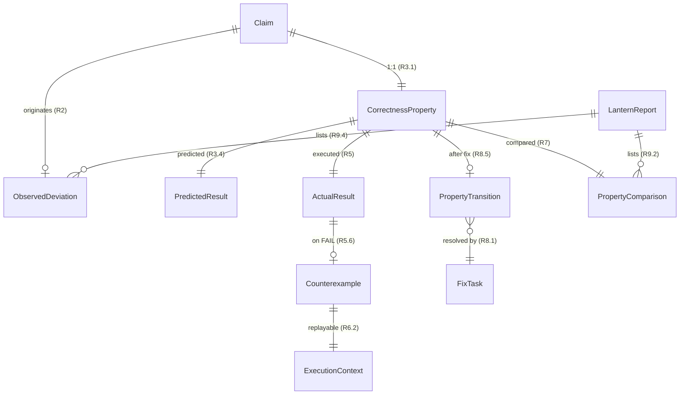

# Design Document

## Overview

spec-lantern resurrects abandoned "vibe-coded" TypeScript/React applications by replacing *reading* with *executing*. The guiding insight, confirmed by a feasibility test, is that an agent reading source code alone will trust misleading comments and draw wrong conclusions: it predicted a "most recent month first" property would PASS because a comment said so, while an executed property-based test proved the code showed the oldest month first (FAIL). spec-lantern therefore extracts each claim into an executable Correctness_Property, records the agent's read-only Predicted_Result *before* execution, runs the property against the real code inside an Isolated_Runner, and surfaces every place the prediction disagreed with reality.

The product is a single pipeline delivered as three cooperating artifacts:

1. **Kiro_Power** (`POWER.md` + steering) — guides Kiro through Reverse_Engineer (EARS requirements + design with Correctness Properties), separating intended from current behavior (Observed_Deviations), extracting each Claim into exactly one Correctness_Property, recording an immutable Predicted_Result, and generating Fix_Tasks for Confirmed_Bugs (the Revive step).
2. **MCP_Server** — executes properties inside the Isolated_Runner (local rootless Podman; AWS later) across a two-phase lifecycle, renders embedded React component logic in jsdom with mocked data and a Controllable_Clock, records an Execution_Context per execution so Counterexamples replay exactly, and returns PASS/FAIL, Counterexamples, timeouts, and execution errors. It also applies fixes to a Target_Repo_Copy and re-executes to record Pre_Fix_Result / Post_Fix_Result / Property_Transition.
3. **Lantern_Report_UI** — a web UI showing predicted vs actual per property side by side, visually flagging prediction mismatches, showing Counterexamples and Property_Transitions, plus a publicly accessible Hosted_Demo on AWS presenting sample reports.

### Design Principles

- **Execute, don't trust.** No PASS/FAIL verdict in a Lantern_Report is ever derived from reading code. Verdicts come only from executed properties. Predictions are kept solely to be *compared against* execution.
- **Host safety is non-negotiable.** Target_Repo code runs *only* inside the Isolated_Runner. A request that would run target code on the host is rejected before anything runs. A missing or broken runner aborts — it never falls back to the host.
- **Determinism by construction.** Every execution fixes its Random_Seed, timezone, and Fixed_Current_Time and records them as an Execution_Context so any Counterexample replays to the identical Actual_Result.
- **The original is sacred.** Fixes are applied only to a Target_Repo_Copy; the user's Target_Repo is never modified.

## Architecture

### System Context

spec-lantern spans three runtime roles: the Kiro agent driven by the Kiro_Power, the MCP_Server process that owns the Isolated_Runner boundary, and the Lantern_Report_UI (local and Hosted_Demo). The Kiro_Power never touches target code directly — it always delegates execution to the MCP_Server, which is the sole owner of the sandbox boundary.



### The End-to-End Pipeline

The pipeline is a single linear flow with one feedback loop (Revive). Each stage names the requirement it satisfies.



### Two-Phase Execution Lifecycle

The runner lifecycle is deliberately split so that the only moment network access exists is while installing dependencies, and even then only to the package registry with install/lifecycle scripts disabled. Once tests run, the network is fully closed.



### Safety Architecture

The MCP_Server is the single chokepoint through which any target code reaches execution. Three enforcement layers guarantee host safety:

1. **Safety Gate (pre-execution).** Every Property_Execution_Request and every fix-application request passes through a gate that classifies the operation. If an operation would run a Target_Repo process, script, or build step in the host process or host shell, the gate rejects it before anything runs, reports a safety violation, and leaves the host filesystem and process state unchanged (R12.1, R12.4).
2. **Runner boundary (during execution).** All target code executes inside the Isolated_Runner. The runner mounts only the Target_Repo (or Target_Repo_Copy) working directory and confines file reads/writes to that boundary (R12.6). Network is governed per phase (R12.2, R12.3).
3. **No-fallback invariant.** If the runner cannot be created or is unavailable, the MCP_Server aborts target execution, reports a runner-unavailable error, and never executes target code on the host (R5.8, R12.5). There is no code path from a runner failure to host execution.

### Technology Choices

- **Property-based testing:** [fast-check](https://fast-check.dev/) for TypeScript. It generates many inputs per property, supports seeded reproduction, and shrinks failing cases to minimal Counterexamples — which maps directly to the Counterexample and Execution_Context requirements. We do not implement property generation from scratch (R6 replay relies on fast-check's seed reproduction).
- **Component rendering:** [jsdom](https://github.com/jsdom/jsdom) via [@testing-library/react](https://testing-library.com/docs/react-testing-library/intro/) to render React components headlessly for Component_Rendered_Property evaluation (R4).
- **Controllable clock:** fake timers (e.g. Vitest/Sinon fake timers) pinned to Fixed_Current_Time plus a fixed `TZ` so time-dependent rendering is deterministic (R4.3, R6.1).
- **Test runner inside the sandbox:** [Vitest](https://vitest.dev/) with the jsdom environment, invoked inside the Isolated_Runner only.
- **Local isolation:** rootless [Podman](https://podman.io/) containers with network namespaces controlled per phase (R5.3, R12.2, R12.3). Rootless avoids host root privileges.
- **MCP transport:** the [Model Context Protocol](https://modelcontextprotocol.io/) TypeScript SDK exposing tools the Kiro_Power calls.
- **Cloud path (later):** AWS Fargate tasks (or Firecracker-backed CodeBuild) provide the same two-phase, network-gated isolation; the Hosted_Demo serves static sample Lantern_Reports from S3 + CloudFront.

## Components and Interfaces

### Component 1: Kiro_Power (`POWER.md` + steering)

Guides Kiro through the read-side of the pipeline. It owns everything up to producing a Property_Execution_Request and everything in the Revive loop except execution.

Responsibilities:
- Reverse_Engineer a Kiro spec: EARS requirements where each identified behavior yields at least one EARS criterion, and a design with a non-empty Correctness_Properties section containing at least one property per requirement (R1.1, R1.2).
- Record each comment-described behavior as a distinct Claim referencing its source file and comment (R1.3).
- Report unreadable or non-analyzable repos without producing a partial spec (R1.4, R1.5).
- Build the Observed_Deviations list, one entry per claimed-vs-current difference, each referencing its originating Claim; empty list when no difference; an "undeterminable" entry when a Claim cannot be evaluated (R2).
- Convert each Claim into exactly one Correctness_Property; record an immutable Predicted_Result before execution; mark unverifiable Claims with a reason (R3).
- Mark embedded component logic and derive Component_Rendered_Properties (R4.1, R4.4).
- Generate at least one Fix_Task per Confirmed_Bug and apply fixes only to the Target_Repo_Copy (R8.1, R8.2).

Interface (steering-level contracts, realized as MCP tool calls and spec files):
- `reverseEngineer(targetRepoPath) -> { requirements, design, claims[] } | ReverseEngineerError`
- `predict(property) -> Predicted_Result` (recorded before any execution; immutable thereafter)

### Component 2: MCP_Server

The sandbox boundary owner. Exposes MCP tools to the Kiro_Power and never runs target code itself — it delegates to the Isolated_Runner.

MCP tools (contracts between Kiro_Power and the runner):

| Tool | Input | Output |
| --- | --- | --- |
| `execute_properties` | `Property_Execution_Request` | `Property_Execution_Result` |
| `apply_fixes_and_reexecute` | `{ targetRepoCopyRef, fixTasks[], properties[] }` | `Property_Execution_Result` with Pre/Post results |
| `replay_counterexample` | `{ property, executionContext }` | `Actual_Result` (must equal the original) |

`execute_properties` behavior:
- Pass the request through the Safety Gate; reject host-bound requests with a safety violation (R12.4).
- Create the Isolated_Runner (rootless Podman locally); on failure return a runner-unavailable execution error with no host fallback (R5.3, R5.8, R12.5).
- Run Dependency_Install_Phase (registry-only network, scripts disabled) fully before Test_Execution_Phase (R5.4, R12.2).
- In Test_Execution_Phase (network fully disabled), execute each property, returning exactly PASS or FAIL on normal completion; a Counterexample on FAIL; a timeout outcome after 30s with no PASS/FAIL; an execution error on uncaught error/load failure with no PASS/FAIL (R5.5–R5.9, R12.3).
- Record an Execution_Context (Random_Seed, timezone, Fixed_Current_Time) per execution and attach it to Counterexamples (R6.1, R6.2).

### Component 3: Isolated_Runner

The sandboxed environment. Local implementation = rootless Podman container; AWS implementation = Fargate task with equivalent guarantees. Shared contract:

- Mount only the target working directory; confine file access to the runner boundary (R12.6).
- Enforce per-phase network policy via network namespace / egress rules.
- Host the Vitest + jsdom harness; inject mocked data and a Controllable_Clock when evaluating embedded component logic (R4.2, R4.3).
- Seed fast-check from the recorded Random_Seed and pin `TZ` + fake timer to Fixed_Current_Time so replay is exact (R6.3).

### Component 4: Comparison Engine (spec-lantern)

Pure logic that pairs predictions with actual results and builds the Lantern_Report.

- Pair Predicted_Result with Actual_Result when both PASS/FAIL exist; flag inequality as a prediction mismatch (R7.1, R7.2).
- Classify FAIL as a Confirmed_Bug and attach its Counterexample (R7.3).
- Exclude timeouts from mismatch flagging and Confirmed_Bug classification, marking "not compared" (R7.4).
- Mark properties with a Predicted_Result but no Actual_Result as "not executed" (R7.5).
- Build Property_Transition from Pre_Fix_Result and Post_Fix_Result, including FAIL→FAIL ("not resolved") and PASS→FAIL ("regression") (R8.4–R8.7).
- Produce the Lantern_Report within 10s of comparison completion, listing every evaluated property, Counterexamples for Confirmed_Bugs, Observed_Deviations, and Property_Transitions, with explicit "none found" indications (R9).

### Component 5: Lantern_Report_UI and Hosted_Demo

A web UI rendering a Lantern_Report.

- Each property row shows Predicted_Result and Actual_Result adjacently (R10.1), rendered within 3s (R10.2).
- A visual indicator marks rows where Predicted differs from Actual, absent where they match (R10.3).
- Confirmed_Bug rows show the Counterexample, or an "unavailable" indication if missing (R10.4, R10.6).
- Property_Transition rows show Pre_Fix_Result and Post_Fix_Result (R10.5).
- A "no report exists" message when no Lantern_Report is available (R10.7).
- The Hosted_Demo is reachable over the public internet with no local install, presents sample Lantern_Reports, and exposes the same predicted-vs-actual, Counterexample, and Property_Transition views (R11).

## Data Models

All models are serializable JSON so they can cross the MCP boundary and be rendered by the UI. PASS/FAIL is a closed enum; timeouts and execution errors are *distinct* outcomes, never encoded as PASS or FAIL (this distinction is central to R5.7, R5.9, R7.4).

```typescript
type Verdict = "PASS" | "FAIL";

// A statement of intended behavior found in the Target_Repo.
interface Claim {
  id: string;
  description: string;        // the claimed behavior
  sourceFile: string;         // R1.3: originating file
  commentRef: string;         // R1.3: the comment/line it was derived from
  unverifiable?: {            // R3.6
    reason: string;
  };
}

// Difference between claimed and current behavior. (R2)
interface ObservedDeviation {
  id: string;
  claimId: string;            // R2.1/R2.2: reference to originating Claim
  claimedBehavior: string;
  currentBehavior: string | null;  // null => could not be determined (R2.4)
  undeterminable?: boolean;        // R2.4
}

// Executable assertion derived 1:1 from a Claim. (R3.1)
interface CorrectnessProperty {
  id: string;
  claimId: string;            // exactly one Claim -> one property
  title: string;
  statement: string;          // "for all ..." universal statement
  kind: "function" | "component_rendered";  // R4
  embeddedComponentLogic?: {  // R4.1
    componentPath: string;
    mockedData: unknown;
  };
  validatesRequirements: string[];  // e.g. ["7.1","7.2"]
}

// Agent's read-only prediction, recorded before execution, immutable after. (R3.4, R3.5)
interface PredictedResult {
  propertyId: string;
  verdict: Verdict;
  recordedAt: string;         // timestamp proving it predates execution
  immutable: true;            // once execution begins it is never rewritten
}

// Reproduction values for a single execution. (R6.1)
interface ExecutionContext {
  randomSeed: number;         // fast-check seed (R6)
  timezone: string;           // e.g. "UTC"
  fixedCurrentTime: string;   // ISO instant pinned by Controllable_Clock
}

// Concrete failing input/output. (R5.6)
interface Counterexample {
  propertyId: string;
  input: unknown;             // values that triggered the failure
  observedOutput: unknown;    // what the code actually produced
  executionContext: ExecutionContext;  // R6.2: bundled for exact replay
}

// Outcome of executing one property. Exactly one of these shapes.
type ActualResult =
  | { propertyId: string; outcome: "VERDICT"; verdict: Verdict; counterexample?: Counterexample }
  | { propertyId: string; outcome: "TIMEOUT"; limitSeconds: 30 }            // R5.7
  | { propertyId: string; outcome: "EXECUTION_ERROR"; reason: string }     // R5.9
  | { propertyId: string; outcome: "RUNNER_UNAVAILABLE"; reason: string }  // R5.8, R12.5
  | { propertyId: string; outcome: "SAFETY_VIOLATION"; reason: string };   // R12.4

// Request/response across the MCP boundary.
interface PropertyExecutionRequest {
  targetRepoRef: string;      // path or copy reference (never executed on host)
  properties: CorrectnessProperty[];
  phase: "initial" | "post_fix";
}
interface PropertyExecutionResult {
  results: ActualResult[];
  executionContexts: Record<string, ExecutionContext>;  // per propertyId
}

// Revive loop. (R8)
interface FixTask {
  id: string;
  confirmedBugPropertyId: string;  // R8.1: >=1 per Confirmed_Bug
  description: string;
  appliesTo: "Target_Repo_Copy";   // R8.2: never the original
}
interface PropertyTransition {
  propertyId: string;
  preFixResult: Verdict;      // R8.4
  postFixResult: Verdict;     // R8.4
  classification:
    | "FIXED"            // FAIL -> PASS
    | "NOT_RESOLVED"     // FAIL -> FAIL (R8.6)
    | "REGRESSION"       // PASS -> FAIL (R8.7)
    | "STILL_PASSING";   // PASS -> PASS
}

// Per-property comparison record built by the Comparison Engine. (R7)
interface PropertyComparison {
  propertyId: string;
  predicted: Verdict | null;
  actual: ActualResult;
  status:
    | "MATCH"
    | "PREDICTION_MISMATCH"   // R7.2
    | "NOT_COMPARED_TIMEOUT"  // R7.4
    | "NOT_EXECUTED";         // R7.5
  confirmedBug: boolean;      // R7.3 (true only when actual verdict is FAIL)
  transition?: PropertyTransition;
}

// The structured report. (R9)
interface LanternReport {
  comparisons: PropertyComparison[];       // one per evaluated property (R9.2)
  observedDeviations: ObservedDeviation[]; // R9.4
  noConfirmedBug: boolean;                 // R9.6
  noObservedDeviation: boolean;            // R9.7
  generatedAt: string;                     // within 10s of comparison (R9.1)
}
```

### Entity Relationships



## Correctness Properties

*A property is a characteristic or behavior that should hold true across all valid executions of a system — essentially, a formal statement about what the system should do. Properties serve as the bridge between human-readable specifications and machine-verifiable correctness guarantees.*

These properties are organized by the pipeline layer they validate. The property-based tests in the Testing Strategy implement them against the pure logic (extraction, comparison, transition classification, safety-gate decisions, policy construction) using mocks for the runner so the logic can be exercised across many inputs cheaply. The keystone properties — prediction mismatch (Property 14) and replay reproducibility (Property 12) — encode the product's central insight and its reproducibility guarantee.

### Property 1: Every identified behavior yields an EARS criterion

*For any* set of identified Target_Repo behaviors, every behavior is expressed as at least one requirements criterion conforming to one of the six EARS patterns.

**Validates: Requirements 1.1**

### Property 2: Every requirement has at least one correctness property

*For any* set of generated requirements, the Correctness_Properties section is non-empty and each requirement maps to at least one correctness property.

**Validates: Requirements 1.2**

### Property 3: Each behavior comment becomes a distinct, referenced Claim

*For any* set of code comments describing intended behavior, each described behavior becomes exactly one distinct Claim whose `sourceFile` and `commentRef` are non-empty and identify where it was derived from.

**Validates: Requirements 1.3**

### Property 4: Observed_Deviations are complete and reference their Claim

*For any* set of evaluated Claims, the Observed_Deviations list contains exactly one entry per claim whose behavior differs or cannot be determined; every entry carries a description of the claimed behavior, a description of the current behavior (or an undeterminable marker), and a valid reference to its originating Claim; claims that could not be evaluated are marked undeterminable while all other evaluated claims are retained.

**Validates: Requirements 2.1, 2.2, 2.4**

### Property 5: No differences yields an empty Observed_Deviations list

*For any* set of Claims in which no claimed behavior differs from current behavior, the Observed_Deviations list has zero entries.

**Validates: Requirements 2.3**

### Property 6: Claim-to-property mapping is exactly one-to-one

*For any* set of identified Claims, the number of generated Correctness_Properties equals the number of expressible Claims and each property references exactly one distinct Claim, with inexpressible Claims instead recorded as unverifiable with a non-empty reason and producing no property.

**Validates: Requirements 3.1, 3.6**

### Property 7: Predicted_Result is a verdict recorded before execution and is immutable

*For any* Correctness_Property converted from a Claim, a Predicted_Result whose verdict is exactly one of PASS or FAIL is recorded with a timestamp preceding execution start, and once execution begins any attempt to change it is a no-op so that later comparison always reads the originally recorded value.

**Validates: Requirements 3.4, 3.5**

### Property 8: Embedded component logic yields a rendered-output property

*For any* logic that resides inside a React component and is not exported as a standalone function, it is marked as embedded component logic and the derived Correctness_Property is of kind `component_rendered` and asserts on the rendered output rather than on source.

**Validates: Requirements 4.1, 4.4**

### Property 9: Rendering under a fixed clock is deterministic

*For any* time-dependent component and any Fixed_Current_Time, rendering the component twice under the Controllable_Clock set to that time produces identical rendered output.

**Validates: Requirements 4.3**

### Property 10: Normal completion returns exactly one verdict

*For any* Correctness_Property whose execution completes without timeout or execution error, the Actual_Result is a VERDICT outcome whose verdict is exactly one of PASS or FAIL and no other outcome shape.

**Validates: Requirements 3.2, 5.5**

### Property 11: Every FAIL carries a Counterexample with its Execution_Context

*For any* Correctness_Property whose Actual_Result verdict is FAIL, the result includes a Counterexample containing the triggering input values and the observed output, and that Counterexample carries a complete Execution_Context (Random_Seed, timezone, Fixed_Current_Time).

**Validates: Requirements 5.6, 6.1, 6.2**

### Property 12: Replay with the recorded Execution_Context reproduces the result

*For any* execution that produced an Actual_Result and an Execution_Context, replaying the same Correctness_Property with that Execution_Context produces an Actual_Result equal to the originally recorded one.

**Validates: Requirements 6.3**

### Property 13: Install phase precedes test phase

*For any* Property_Execution_Request, the Dependency_Install_Phase completes before the Test_Execution_Phase begins.

**Validates: Requirements 5.4**

### Property 14: Prediction mismatch is flagged exactly when predicted differs from actual

*For any* Correctness_Property with a recorded Predicted_Result and an Actual_Result verdict, the property is flagged as a prediction mismatch if and only if the predicted verdict is unequal to the actual verdict.

**Validates: Requirements 7.1, 7.2**

### Property 15: FAIL classifies a Confirmed_Bug with its Counterexample; non-FAIL does not

*For any* Correctness_Property, it is classified as a Confirmed_Bug with its Counterexample associated if and only if its Actual_Result verdict is FAIL.

**Validates: Requirements 7.3**

### Property 16: Timeout outcomes are excluded from comparison

*For any* Correctness_Property whose outcome is a timeout, it is marked not-compared and is excluded from prediction-mismatch flagging and from Confirmed_Bug classification.

**Validates: Requirements 7.4**

### Property 17: Predicted-only properties are marked not executed

*For any* Correctness_Property with a recorded Predicted_Result but no Actual_Result, it is marked not executed and is neither paired as a prediction mismatch nor classified as a Confirmed_Bug.

**Validates: Requirements 7.5**

### Property 18: Every Confirmed_Bug produces at least one Fix_Task

*For any* Correctness_Property classified as a Confirmed_Bug, at least one Fix_Task referencing that property is generated.

**Validates: Requirements 8.1**

### Property 19: Fixes modify only the copy, never the original

*For any* Fix_Task application, the write targets only the Target_Repo_Copy and the original Target_Repo is left byte-for-byte unchanged.

**Validates: Requirements 8.2**

### Property 20: Both pre-fix and post-fix results are recorded on re-execution

*For any* Correctness_Property re-executed after a fix, both the Pre_Fix_Result and the Post_Fix_Result are recorded as the Actual_Result of that property before and after the fix.

**Validates: Requirements 8.4**

### Property 21: Property_Transition classification matches the pre/post pair

*For any* pair of a Pre_Fix_Result and a Post_Fix_Result, a Property_Transition is produced that pairs both verdicts and whose classification is FIXED for FAIL→PASS, NOT_RESOLVED for FAIL→FAIL, REGRESSION for PASS→FAIL, and STILL_PASSING for PASS→PASS.

**Validates: Requirements 8.5, 8.6, 8.7**

### Property 22: The report lists every evaluated property with predicted and actual

*For any* set of evaluated Correctness_Properties, the Lantern_Report contains exactly one comparison entry per evaluated property, each carrying its Predicted_Result and Actual_Result.

**Validates: Requirements 9.2**

### Property 23: The report includes counterexamples, deviations, and transitions it was given

*For any* Lantern_Report, each Confirmed_Bug entry includes its Counterexample (triggering input/state and resulting Actual_Result), each Observed_Deviation produced during analysis is listed with its associated Correctness_Property and a description of how the Actual_Result differs from the Predicted_Result, and each recorded Property_Transition presents its Pre_Fix_Result and Post_Fix_Result.

**Validates: Requirements 9.3, 9.4, 9.5**

### Property 24: Empty collections produce explicit indications

*For any* Lantern_Report, when no Correctness_Property is a Confirmed_Bug the report sets a no-Confirmed_Bug indication, and when no Observed_Deviation was recorded the report sets a no-Observed_Deviation indication.

**Validates: Requirements 9.6, 9.7**

### Property 25: Each rendered row shows predicted and actual adjacently

*For any* available Lantern_Report, every rendered Correctness_Property row contains its Predicted_Result and Actual_Result positioned adjacently within the same row.

**Validates: Requirements 10.1**

### Property 26: The UI mismatch indicator is present exactly on mismatched rows

*For any* available Lantern_Report, a rendered Correctness_Property row carries the mismatch visual indicator if and only if its Predicted_Result differs from its Actual_Result.

**Validates: Requirements 10.3**

### Property 27: The UI renders counterexamples and transitions it is given

*For any* available Lantern_Report, every Confirmed_Bug row with a Counterexample renders that Counterexample, and every row with a Property_Transition renders its Pre_Fix_Result and Post_Fix_Result.

**Validates: Requirements 10.4, 10.5**

### Property 28: Accepted executions always target the runner, never the host

*For any* Property_Execution_Request or fix-application request that the Safety Gate accepts, the chosen execution target is the Isolated_Runner and no Target_Repo process, script, or build step runs in the host process or host shell.

**Validates: Requirements 5.2, 12.1**

### Property 29: Host-bound requests are rejected before any code runs

*For any* request that would cause Target_Repo code to execute outside the Isolated_Runner, the request is rejected before any Target_Repo code runs, a safety violation is reported, and the host filesystem and host process state are left unchanged.

**Validates: Requirements 12.4**

### Property 30: Runner unavailability aborts without host fallback

*For any* condition in which the Isolated_Runner cannot be created or is unavailable, execution is aborted with a runner-unavailable execution error that identifies the reason and no Target_Repo code is executed on the host.

**Validates: Requirements 5.8, 12.5**

### Property 31: Target code that errors or fails to load yields an execution error

*For any* Correctness_Property whose Target_Repo code raises an uncaught error or fails to load, an execution error identifying the reason is returned and no PASS or FAIL Actual_Result is produced for it.

**Validates: Requirements 5.9**

### Property 32: Timeouts terminate with no verdict

*For any* Correctness_Property execution exceeding its 30-second limit, the execution is terminated and a timeout outcome is returned with no PASS or FAIL Actual_Result.

**Validates: Requirements 5.7**

### Property 33: Install-phase network policy allows only the package registry with scripts disabled

*For any* Dependency_Install_Phase, outbound network access is permitted only to the package registry and install/lifecycle scripts are disabled.

**Validates: Requirements 12.2**

### Property 34: Test-phase network is fully disabled for the whole phase

*For any* Test_Execution_Phase, all inbound and outbound network access is disabled for the entire duration from phase start until process termination.

**Validates: Requirements 12.3**

### Property 35: Target file access is confined to the runner boundary

*For any* Target_Repo file operation during execution, access is permitted only within the Isolated_Runner boundary and reads or writes outside that boundary are prevented.

**Validates: Requirements 12.6**

## Error Handling

Errors are modeled as distinct, typed outcomes rather than as PASS/FAIL verdicts, because conflating them would corrupt the predicted-vs-actual comparison. The outcome taxonomy in the data model (`VERDICT`, `TIMEOUT`, `EXECUTION_ERROR`, `RUNNER_UNAVAILABLE`, `SAFETY_VIOLATION`) is the single source of truth.

| Condition | Handling | Requirement |
| --- | --- | --- |
| Target_Repo unreadable | Reverse_Engineer reports it cannot proceed with a specific human-readable reason; no partial spec is written | 1.4 |
| No analyzable TypeScript source | Reverse_Engineer reports it cannot proceed with a "no analyzable TypeScript source found" message; no partial spec | 1.5 |
| Claim not expressible as a property | Claim recorded as unverifiable with a reason; no property emitted | 3.6 |
| Claim not evaluable against current behavior | Observed_Deviation records the claim as undeterminable; other claims retained | 2.4 |
| Kiro-side property test non-terminating | Test halted at 60s and recorded FAIL with a timeout reason | 3.3 |
| Runner-side execution exceeds 30s | Execution terminated; `TIMEOUT` outcome returned with no verdict; excluded from comparison | 5.7, 7.4 |
| Target code uncaught error / load failure | `EXECUTION_ERROR` outcome with reason; no verdict | 5.9 |
| Isolated_Runner cannot be created / unavailable | `RUNNER_UNAVAILABLE` outcome with reason; execution aborted; **no host fallback** | 5.8, 12.5 |
| Request would run target code on the host | Rejected at the Safety Gate before any code runs; `SAFETY_VIOLATION` reported; host state unchanged | 12.4 |
| Confirmed_Bug missing a Counterexample in the UI | UI shows a Counterexample-unavailable indication | 10.6 |
| No Lantern_Report available | UI shows a "no report exists" message | 10.7 |

Two safety invariants override all other error handling: (1) there is no code path from any error condition to executing target code on the host, and (2) a safety violation or runner failure must leave the host filesystem and process state unchanged.

## Testing Strategy

spec-lantern uses a dual approach. Property-based tests cover the universal properties above; example, edge-case, and integration tests cover specific scenarios, boundaries, infrastructure wiring, and timing that are not amenable to property-based testing.

### Property-Based Tests

- **Library:** [fast-check](https://fast-check.dev/) with [Vitest](https://vitest.dev/). We do not implement property generation or shrinking from scratch — fast-check's seeded generation underpins the Execution_Context replay guarantee.
- **Iterations:** each property-based test runs a minimum of 100 iterations.
- **Tagging:** each property-based test is tagged with a comment in the form **Feature: spec-lantern, Property {number}: {property_text}** referencing the property it implements.
- **Single test per property:** each Correctness Property above is implemented by exactly one property-based test.
- **Mocks for the runner:** properties about the pure logic (extraction, comparison, transition classification, safety-gate decision, phase/network policy construction, report assembly) run against the logic directly with the Isolated_Runner mocked, so 100+ iterations stay cheap. Component-rendered properties (8, 9, 25, 26, 27) render in jsdom with mocked data and the Controllable_Clock.
- **Coverage map:** Properties 1–8 cover extraction/deviation logic (R1–R4); 9 covers clock determinism (R4.3); 10–13 cover runner execution outcomes and phase ordering (R3.2, R5); 11–12 cover reproducibility (R6); 14–17 cover the prediction/actual comparison (R7); 18–21 cover the Revive loop (R8); 22–24 cover report assembly (R9); 25–27 cover UI rendering (R10); 28–35 cover host safety and execution policy (R5.7–R5.9, R12).

### Example and Edge-Case Unit Tests

Used where behavior does not vary meaningfully across inputs or where a precise boundary/scenario is the point:

- **R1.4 / R1.5** — unreadable repo and no-analyzable-TypeScript branches: assert the specific failure report and that no partial spec is written.
- **R3.3** — Kiro-side 60s non-termination guard, driven by a mocked timer: assert halt at 60s and FAIL-with-timeout.
- **R3.6** — inexpressible Claim: assert the unverifiable record and reason.
- **R9.1** — report produced within 10s of comparison completion (timed).
- **R10.2** — UI renders all entries within 3s (timed).
- **R10.6** — Confirmed_Bug with no Counterexample: assert the unavailable indication.
- **R10.7** — no Lantern_Report: assert the no-report message.

### Integration Tests

Used for infrastructure and external-service wiring where input variation does not reveal logic bugs; run with 1–3 representative cases:

- **R4.2** — render a representative embedded-logic component in jsdom with injected mocked data and assert the render used the injected data.
- **R5.1 / R5.3** — a request is dispatched into the runner (not the host); the local runner is a rootless Podman container (smoke check).
- **R8.3** — after fixes are applied to the Target_Repo_Copy, the same property set is re-executed against the copy inside the runner.
- **R11.1 / R11.2 / R11.3** — the Hosted_Demo is reachable over the public internet without local install, presents sample Lantern_Reports, and exposes the predicted-vs-actual, Counterexample, and Property_Transition views (reusing the UI property tests for view parity).

### Safety Verification

Because host safety is the product's core guarantee, the safety-gate and runner-boundary logic (Properties 28–35) are tested both as property-based tests (over generated requests and policies) and with targeted negative tests that attempt to escape the boundary and assert the host filesystem and process state remain unchanged.
