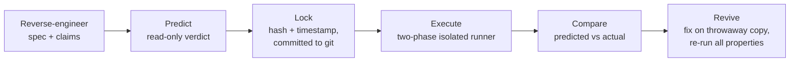

# spec-lantern 🎃

> AI reviewers read a comment, believe it, and sign off. spec-lantern executes every claim a comment makes and reports where the code lies.

**Hosted demo:** <https://d2xayupxggkiqt.cloudfront.net/> ([base URL in source](./packages/ui/src/site-meta.ts))
· **3-minute video:** _(placeholder — to be added)_

Built for [Kiroween 2026](https://kiroween.devpost.com/), category: Resurrection.

---

## 1. Why

An AI code reviewer that only *reads* a repo trusts the comments it finds. In the
feasibility test ([steering: feasibility-learnings.md](./.kiro/steering/feasibility-learnings.md)),
a comment said `// Reverse to have most recent month first`, Kiro read
`periods.reverse()`, judged the two in agreement, and predicted PASS. Executing
a property-based test proved the opposite — the *oldest* month was shown first.

That PASS-predicted / FAIL-executed gap is the whole product. spec-lantern turns
every claim a comment makes into an **executable property**, records Kiro's
read-only prediction, **locks it before anything runs**, then executes in an
isolated runner and compares prediction against reality.

## 2. What it found

Two abandoned, AI-generated repos. Each claim below is quoted verbatim from the
target source; each verdict was locked before execution and observed from a real
run. Full artifacts are linked.

### writing-tracker ([claims](./packages/mcp-server/skeleton/writing-tracker-full/claims.json) · [run results](./packages/mcp-server/skeleton/writing-tracker-full/results))

| Lying comment (file:line) | Kiro predicted | Execution proved | Fix | Transition |
|---|---|---|---|---|
| `// Reverse to have most recent month first` — [`PeriodProgressSummary.tsx:54`](./packages/mcp-server/skeleton/writing-tracker-full/claims.json) | **PASS** | **FAIL** — with `now = Jan 2000`, the first monthly row was `Aug 1999`, not `Jan 2000` ([counterexample](./packages/mcp-server/skeleton/writing-tracker-full/results/stage-c/property-1.claim-monthly-order.json)) | delete `periods.reverse()` (−2 lines) — [diff](./packages/mcp-server/skeleton/writing-tracker-full/results/stage-d/fix-task-1.diff) | **FIXED** (FAIL→PASS); other 2 properties STILL_PASSING ([transitions](./packages/mcp-server/skeleton/writing-tracker-full/results/stage-d/apply-fixes-reexecute-all.json)) |

3 properties executed, 1 Confirmed_Bug. One claim
(`// Get the top 5 stages`) was recorded [unverifiable](./packages/mcp-server/skeleton/writing-tracker-full/claims.json)
because it reads from Supabase with no deterministic path.

### MoodPlays ([claims](./packages/mcp-server/skeleton/moodplays/claims.json) · [run results](./packages/mcp-server/skeleton/moodplays/results))

| Lying comment (file:line) | Kiro predicted | Execution proved | Fix | Transition |
|---|---|---|---|---|
| `// Check for 24 hours` — [`openingHoursParser.ts:51`](./packages/mcp-server/skeleton/moodplays/claims.json) (code was `includes('24')`) | **PASS** | **FAIL** — a normal range like `10:00-22:00` whose closing time contains `24` (e.g. `13:24`) was dropped as "open 24h" ([counterexample](./packages/mcp-server/skeleton/moodplays/results/stage-c/property-1.claim-24h-to-minutes.json)) | match real 24h phrasing with a regex (1-line condition) — [diff](./packages/mcp-server/skeleton/moodplays/results/stage-d/fix-task-1.diff) | **FIXED** (FAIL→PASS) |

10 properties executed, 2 FAILs ([property-1](./packages/mcp-server/skeleton/moodplays/results/stage-c/property-1.claim-24h-to-minutes.json)
and [property-6](./packages/mcp-server/skeleton/moodplays/results/stage-c/property-6.claim-stale-closed.json)) —
both symptoms of the same `includes('24')` substring bug. The single one-line fix
turned both FAIL→PASS and left the other 8 STILL_PASSING, with no regression
([transitions](./packages/mcp-server/skeleton/moodplays/results/stage-d/apply-fixes-reexecute-all.json)).

MoodPlays was chosen by fixed criteria **before** any claim was verified — see
[§10](#10-credits-and-license) and [docs/target-selection.md](./docs/target-selection.md).

## 3. How it works



1. **Predict** — Kiro reverse-engineers a spec, extracts each comment into one
   executable Correctness_Property, and records a read-only, comment-trusting
   verdict ([POWER.md](./packages/kiro-power/POWER.md)).
2. **Lock** — every prediction is hashed and timestamped by the `lock_prediction`
   MCP tool and committed **before execution**, so it can never be edited to
   match the result ([prediction-lock](./packages/mcp-server/src/prediction-lock)).
   See the writing-tracker lock committed at Stage B in
   [`00191a6`](https://github.com/ikenyal/spec-lantern/commit/00191a6).
3. **Execute** — properties run inside the two-phase isolated runner (below),
   never on the host.
4. **Compare** — locked prediction vs observed result; a mismatch is flagged and
   a FAIL becomes a Confirmed_Bug with its counterexample
   ([comparison](./packages/mcp-server/src/comparison)).
5. **Revive** — each Confirmed_Bug gets a minimal Fix_Task applied to a
   **throwaway copy**; all properties re-run to classify FIXED / NOT_RESOLVED /
   REGRESSION / STILL_PASSING ([revive](./packages/mcp-server/src/revive)).

## 4. Safety model (what the code enforces)

Target code runs **only** inside a rootless Podman isolation boundary. The two
overriding invariants — *no host execution* and *no host fallback* — are enforced
in code, not by convention:

- **Two-phase runner.** Dependencies install behind an internal-only Podman
  network whose single outbound peer is a Verdaccio registry proxy, with
  `npm install --ignore-scripts` ([install-phase.ts](./packages/mcp-server/src/runner/install-phase.ts)).
  The install topology is then torn down and the property runs with
  `--network none` — no inbound or outbound access for the whole phase
  ([test-phase.ts](./packages/mcp-server/src/runner/test-phase.ts)).
- **No host fallback.** If Podman is unavailable the runner returns
  `RUNNER_UNAVAILABLE` and stops; there is no code path to host execution
  ([isolated-runner.ts](./packages/mcp-server/src/runner/isolated-runner.ts)).
- **Safety Gate.** Every request is classified before anything runs; host-bound
  operations are rejected as `SAFETY_VIOLATION` ([safety-gate](./packages/mcp-server/src/safety-gate)).
- **Boundary confinement.** Only the one target working directory is mounted —
  never `$HOME`, `/tmp`, or any broad path.
- The original repo is never touched: fixes and executions always run on a
  throwaway copy ([`a006a49`](https://github.com/ikenyal/spec-lantern/commit/a006a49)).

## 5. Honesty by construction

A tool that catches lying reports must not produce one. Several guardrails, and
the times spec-lantern caught **its own** mistakes:

- **Report data fidelity.** Claims are quoted verbatim with exact file:line;
  verdicts and counterexamples come only from real execution; unverifiable claims
  are omitted, not guessed ([steering](./.kiro/steering/report-data-fidelity.md),
  rule added in [`9c7b584`](https://github.com/ikenyal/spec-lantern/commit/9c7b584)).
- **Independent oracles.** Oracles are checked against real-world values and the
  comment's own examples, never by restating the implementation
  ([power steering](./packages/kiro-power/steering/03-claims-to-properties.md),
  [`cddd72b`](https://github.com/ikenyal/spec-lantern/commit/cddd72b),
  [`32661f3`](https://github.com/ikenyal/spec-lantern/commit/32661f3)).
- **Superseded locks with READMEs.** A locked prediction is never edited; when a
  property's harness legitimately changes, the old lock moves to
  `locks/superseded/` with a note explaining what changed and what did not
  ([writing-tracker](./packages/mcp-server/skeleton/writing-tracker-full/locks/superseded/README.md),
  [MoodPlays](./packages/mcp-server/skeleton/moodplays/locks/superseded/README.md)).
- **Root-cause counting.** MoodPlays' two FAILs were both symptoms of one
  `includes('24')` bug and are counted as a single lie, not two — the UI labels
  the second as a symptom ([`18043de`](https://github.com/ikenyal/spec-lantern/commit/18043de)).

Cases where spec-lantern caught its own errors:

- **Safety Gate bypass found by a property test.** A property-based test found the
  gate could be bypassed by a host-command prefix; it was fixed to match on whole
  tokens ([`70d61ad`](https://github.com/ikenyal/spec-lantern/commit/70d61ad)).
- **Harness defects not reported as bugs.** writing-tracker properties 2 and 3
  first produced an EXECUTION_ERROR and a trim-mismatch FAIL — defects in the
  test harness, not the target. They were fixed in the property files only, the
  predicted PASS carried over, and neither was reported as a target bug
  ([Stage C harness revision, `be4c190`](https://github.com/ikenyal/spec-lantern/commit/be4c190)).
- **Tautological oracles rewritten before execution.** MoodPlays oracles that
  merely restated the code were caught in review and rewritten to use independent
  sources — all before any execution ran
  ([`2b34958`](https://github.com/ikenyal/spec-lantern/commit/2b34958),
  [`d81cf0a`](https://github.com/ikenyal/spec-lantern/commit/d81cf0a)).
- **Packaged-power trial found repo-mutation and staging bugs.** Running the
  packaged Power surfaced that `execute_properties` could mutate the original
  repo; the fix routes every run through a throwaway working copy
  ([`a006a49`](https://github.com/ikenyal/spec-lantern/commit/a006a49),
  [`389a54f`](https://github.com/ikenyal/spec-lantern/commit/389a54f)).

## 6. Try it on your repo

spec-lantern ships as a Kiro Power. Point it at your own TypeScript/React repo
and it executes every claim your comments make instead of trusting them. The
packaged Power is produced by `npm run package:power`
([`4ad4b75`](https://github.com/ikenyal/spec-lantern/commit/4ad4b75)).

**Requirements**

- **Kiro** (the AI IDE that loads Powers)
- **Node.js 20 or newer**
- **rootless Podman** — on macOS run `podman machine start` first; target code
  only ever runs inside Podman, never on your host

**Install**

1. Open **Powers** in Kiro.
2. Choose **Add Custom Power → Import power from GitHub**.
3. Paste <https://github.com/ikenyal/spec-lantern-power>.

Then just ask:

> Check the comments in this repo — are any of them lying about what the code does?

## 7. How Kiro was used

- **Spec-driven development.** The whole build was driven by a Kiro spec:
  [requirements](./.kiro/specs/spec-lantern/requirements.md) →
  [design](./.kiro/specs/spec-lantern/design.md) →
  [tasks](./.kiro/specs/spec-lantern/tasks.md).
- **Steering files** in [`.kiro/steering`](./.kiro/steering):
  - `feasibility-learnings.md` — the proven predict→lock→execute pipeline and the
    "never run target code on the host" rule.
  - `report-data-fidelity.md` — verbatim claims, observed-only verdicts, no
    fabricated rows.
  - `hosted-demo-aws.md` — the AWS constraints for the demo (profile, region,
    private bucket + CloudFront, approval before deploy).
  - `task20-e2e-stages.md` / `second-target-moodplays.md` — the staged runs with
    stop points for the two end-to-end targets.
- **Kiro Power + MCP server.** A [Kiro Power](./packages/kiro-power) steers the
  authoring; an [MCP server](./packages/mcp-server) owns execution and exposes
  `lock_prediction`, `execute_properties`, `apply_fixes_and_reexecute`, and
  `replay_counterexample`.
- **Property-based tests.** Correctness_Properties use fast-check + Vitest, one
  property per claim, ≥100 iterations.
- **Staged runs with stop points.** Both targets ran in stages (claims → lock →
  execute → revive → report), stopping for review between each.
- **Autopilot vs supervised mode.** Autopilot for the bulk of the build;
  supervised review at the safety-sensitive and locking boundaries.
- **Workflows.** Used for larger multi-step work and review loops.

## 8. Repository layout

```
packages/
  types/        shared artifact + domain types
  kiro-power/   POWER.md + steering that drives Kiro's authoring
  mcp-server/   Safety Gate, two-phase Podman runner, comparison, revive, report
    skeleton/   per-target artifacts + locked predictions + run results
  ui/           Lantern_Report_UI (React + Vite)
  infra/        AWS CDK app for the static Hosted_Demo
docs/           target-selection.md, mobile check notes
.kiro/          specs/ (requirements, design, tasks) + steering/
```

### Development commands

```sh
npm run typecheck                    # tsc --build across the monorepo
npm run test                         # Vitest (fast-check property tests)
npm run lint                         # eslint
npm run build                        # build all workspaces
npm run build:demo -w @spec-lantern/ui   # export reports + build the static UI
npm run package:power                # produce the standalone Kiro Power
npm run dev -w @spec-lantern/ui      # view the report UI locally
```

## 9. Hosted demo infrastructure (AWS)

The public demo is a **static site** — the built Lantern_Report_UI plus the
pre-generated writing-tracker and MoodPlays report JSON. It contains **no runner**
and never executes target code; it only serves static assets. The report data is
real pipeline output, not sample data.

Infrastructure lives in [`packages/infra`](./packages/infra) as an AWS CDK
(TypeScript) app: a **private S3 bucket** (Block Public Access on) served only
through **CloudFront** via Origin Access Control, HTTPS-only, with security
headers and cache invalidation on every redeploy
([hosted-demo-stack.ts](./packages/infra/lib/hosted-demo-stack.ts)). Every
resource is tagged `Project=spec-lantern` and `Event=Kiroween2026`.

**Prerequisites.** AWS credentials for profile **`brightflow-sandbox-ikeda`**
(account `402040564721`, region `ap-northeast-1`); all commands use this profile.
A one-time `cdk bootstrap` of that account/region is required (run it after
reviewing the diff).

```sh
# Bootstrap once (after reviewing the diff):
cd packages/infra && npx cdk bootstrap --profile brightflow-sandbox-ikeda
```

**Deploy.** Always review the planned change first:

```sh
npm run build:demo -w @spec-lantern/ui     # produce packages/ui/dist
npm run diff -w @spec-lantern/infra        # review: cdk diff
npm run deploy:demo                        # build:demo + cdk deploy (real AWS deploy)
```

> ⚠️ `npm run deploy:demo` performs a real AWS deploy. Only deploy once the
> `cdk diff` output looks right. The public URL is the `DistributionUrl` stack
> output.

**Destroy.**

```sh
npm run destroy:demo
```

This tears down the CloudFront distribution and empties/removes the throwaway
bucket.

## 10. Credits and license

- **writing-tracker** — © 2025 shateer, MIT ([sandbox/writing-tracker/LICENSE](./sandbox/writing-tracker/LICENSE)).
- **MoodPlays** — `gargi04sahu/MoodPlays` @ `4b4152f`, © 2026 Gargi Sahu, MIT
  ([sandbox/moodplays/LICENSE](./sandbox/moodplays/LICENSE)). Selected by fixed
  criteria **before** any claim was verified — chosen for testability, not for a
  suspected bug ([docs/target-selection.md](./docs/target-selection.md)).
- spec-lantern — © 2026 ikenyal, [MIT](./LICENSE).
